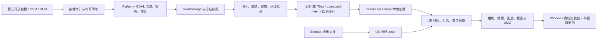

# SG-City 新加坡离线三维城市地图技术方案

- **文档状态**：已开始实施；工程骨架与滨海湾 P0 离线数据完成，等待 UE 5.8 环境验证
- **文档版本**：v0.1
- **编制日期**：2026-11-02
- **项目目录**：`E:\SG-City`
- **目标交付物**：Windows 10/11 x64 离线桌面应用及配套本地数据包
- **核心技术**：Unreal Engine 5.8 + Cesium for Unreal 2.31.0 + 3D Tiles

> 本方案交付的是 **UE 离线桌面程序，不是网站**。武汉网页仅用于参考交互和视觉组织，不在本项目中复用 Three.js 技术栈。
>
> **实施快照（2026-11-02）**：UE C++ 骨架、本地瓦片加载、P0 相机和滨海湾离线数据已完成；数据结构校验通过。UE 编译、编辑器视觉验收和打包被本机缺少 UE 5.8 阻塞。

---

## 1. 结论与推荐路线

采用“**真实 GIS 数据离线预处理 → 3D Tiles 本地瓦片集 → Cesium for Unreal 流式加载 → UE 风格化渲染与交互**”路线。

不要一开始制作整个新加坡。先完成滨海湾约 3–5 km 范围的垂直切片，验证以下四件事，再扩展到全城：

1. 地形、道路、建筑和岸线能否对齐。
2. 本地瓦片能否在打包后的程序中断网加载。
3. 截图要求的深青色夜景、发光道路和暗色建筑能否稳定复现。
4. 目标硬件上的帧率、显存和加载时间是否达标。

核心原则：

- **数据先行**：先冻结数据快照，再开发场景；禁止运行时调用在线地图接口。
- **垂直切片**：先做小范围完整闭环，不做“全城但只有半成品”的场景。
- **骨肉皮分层**：先地形、岸线和主路网，再建筑，再地标，最后车辆、灯光等动态装饰。
- **版本冻结**：UE、Cesium、数据、材质和导出工具均锁定版本，项目中后期不追新。
- **阶段门禁**：上一阶段未通过验收，不进入全城铺量。

---

## 2. 参考资料解读

### 2.1 微信公众号文章

参考文章：《30轮对话·14MB地图·15000栋楼：我把江城搬进了浏览器》。

可复用的方法：

- 使用真实 OpenStreetMap 数据，而不是让程序臆造城市位置。
- 数据切片获取、统一投影、统一比例尺和确定性随机。
- 建筑高度缺失时采用明确标注的推断值。
- 先数据、再骨架、再建筑肌理、最后动态效果。
- 桥梁偏位、地表闪烁、航线进入支流等问题必须通过实际渲染和地理控制点验收。

不可直接复用的部分：

- 武汉项目使用 Three.js 在浏览器中运行时生成城市；本项目应在制作阶段生成 3D Tiles，运行时只加载和渲染。
- 武汉项目的局部平面投影不适合直接替代本项目的 WGS84 / ECEF 地理参考链路。
- 武汉项目的加载时间和程序化生成方式不作为本项目验收标准。

### 2.2 武汉在线场景

页面实际包含：全景与地标机位、旋转缩放平移、地标信息、昼夜时间轴、小地图、空中巡游、街景漫游、截图、音效和画质档位。

本项目建议继承：机位切换、地标信息、图层控制、截图和画质档位；巡游列为后续可选。

不建议首版继承：烟花、音效、复杂交通、街景漫游和完整昼夜循环。这些不是离线地图的核心，过早加入只会拖慢全城交付。

### 2.3 用户截图

截图的目标风格不是写实卫星图，而是深色科技夜景：

- 深青色地面和低亮度背景。
- 绿色至青绿色发光路网，主次道路亮度不同。
- 深蓝黑色建筑体块，屋顶偏暗，立面有青绿色和少量暖色灯光。
- 河流和港湾轮廓清晰，水面比陆地稍亮，但不能抢过路网。
- 城市建筑密集、道路层次清楚，整体有薄雾和适度 Bloom。

因此，首版应做“**风格化三维城市地图**”，不是照片级数字孪生，也不应宣称建筑高度和外观全部真实。

---

## 3. 项目目标与边界

### 3.1 首版目标

1. 在经批准的新加坡范围内展示真实位置的地形、岸线、道路、建筑和主要水体。
2. 默认提供与参考图接近的夜景风格。
3. 支持旋转、缩放、平移、地标飞行、图层开关、本地搜索、截图和画质切换。
4. 所有地图、模型、材质、字体和搜索索引均随包分发。
5. 断网、禁用网卡或防火墙全阻断时仍可完整使用。
6. 支持在目标 Windows 电脑上独立运行，不要求安装 UE 编辑器或 GIS 软件。

### 3.2 非首版目标

- 不做网页版本、手机版本或多人在线服务。
- 不做实时交通、在线天气、在线地理编码和 Cesium ion 在线资源。
- 不做车载导航、航道导航、测量或安全关键用途。
- 不承诺 OSM 缺失区域的建筑轮廓、高度和层数真实。
- 不在首版制作全城照片级模型、全城室内模型或全量高精地标。
- 不使用 Google Maps / Google Earth 的数据、影像或模型，避免许可风险。

### 3.3 建议地理范围

- 新加坡本岛及 Sentosa、Pulau Ubin、Pulau Tekong、Jurong Island 等主要近岸岛屿。
- 岸线外保留一定海域作为视觉背景。
- 马来西亚、印度尼西亚只保留低精度远景或不显示，不进入详细制作范围。
- 最终 WGS84 边界框在数据审计阶段冻结，并写入数据清单。

---

## 4. 版本与范围基线

### 4.1 软件基线

| 项目 | 推荐基线 | 说明 |
|---|---|---|
| Unreal Engine | **5.8** | 使用 C++ 项目，Blueprint 负责 UI 与轻量交互 |
| Cesium for Unreal | **2.31.0，UE 5.8 对应包** | 官方 2026-11-02 版本，支持 UE 5.6/5.7/5.8 |
| 目标平台 | Windows 10/11 x64，DX12 | 首版只保证 Windows 独立程序 |
| IDE | Visual Studio 2022 | 安装 C++ 游戏开发及 UE 所需组件 |
| 数据管线 | Node.js 22 项目内源码 | P0 已实现；QGIS + GDAL/OGR 用于后续数据审计和复杂修复 |
| 中间数据 | GeoPackage / GeoJSON / OSM PBF | GeoPackage 为主要中间格式，避免首版引入重型数据库 |
| 三维交换 | glTF 2.0 / 3D Tiles 1.1 | 保留稳定要素 ID 和属性元数据 |
| 地标制作 | Blender + glTF 导出 | 仅制作审批后的重点地标 |
| 版本管理 | Git；大二进制独立管理 | 全城瓦片不直接塞入 Git 历史 |

版本选择原因：本机当前只能安装 UE 5.8，而 UE 5.8 已受 Cesium for Unreal 2.31.0 正式支持，因此工程改为 5.8 锁定。P0 启动验证后生成 `versions.lock`，后续升级必须单独审批并重新跑离线和性能测试。

### 4.2 建议验收硬件

以下为**待批准的性能验收基线**，不是最低运行配置：

- 6 核或以上桌面 CPU。
- 32 GB 内存。
- NVIDIA RTX 3060 12 GB 或同等级显卡。
- NVMe SSD。
- 1920×1080，DX12，均衡画质。

若实际展示机器不同，必须在 P0 前替换此基线，否则性能指标没有可执行意义。

---

## 5. 总体架构



### 5.1 模块职责

| 模块 | 职责 | 明确不负责 |
|---|---|---|
| 数据工程 | 下载、审计、清洗、坐标转换、切片、校验、版本清单 | 不在 UE 运行时重新生成城市 |
| Cesium 地理场景 | WGS84 地理参考、3D Tiles 调度、本地瓦片加载、原点管理 | 不访问 Cesium ion 默认资产 |
| 视觉渲染 | 地面、道路、建筑、水体材质，灯光、雾、后期和画质档位 | 不修改地理数据真相 |
| 交互 | 相机、书签、图层、拾取、搜索、截图 | 不调用在线搜索或在线路由 |
| 应用框架 | 启动检查、数据路径、错误提示、日志、配置、版本信息 | 不把开发机绝对路径写入发布包 |
| 测试与发布 | 数据校验、性能、断网、安装、长时间运行和交付校验 | 不只验证编辑器内效果 |

---

## 6. 数据方案

### 6.1 数据源优先级

| 数据 | 首选 | 补充/回退 | 处理要求 |
|---|---|---|---|
| 行政与规划边界 | data.gov.sg / SLA / OneMap 可下载数据 | OSM | 逐项核查 Singapore Open Data Licence 和署名要求 |
| 道路、建筑、岸线、水体、POI | 官方开放数据 | OSM PBF | 保留来源字段，不混成无法追溯的数据层 |
| 地形 DEM | 可分发官方 DEM | Copernicus DEM / SRTM 等合规数据 | 固定分辨率、采集日期、垂直基准和许可 |
| 建筑高度 | 官方高度或可靠属性 | OSM `height`、`building:levels` | 缺失值只能推断，必须标记为估算 |
| 地标 | 合规自制模型 | 简化体块 | 模型、照片和纹理分别记录许可 |
| 搜索数据 | 官方 POI / OSM | 人工校订表 | 生成离线索引，不调用 Nominatim 在线服务 |

每个数据快照必须记录：`source_url`、下载日期、原始文件校验和、许可、署名文本、原始坐标系、垂直基准、处理脚本版本和导出数据版本。未通过许可审计的数据不得进入发布包。

OSM 数据须显示 `© OpenStreetMap contributors`，明确 ODbL；若分发衍生数据库，还须按 ODbL 处理相应数据提供义务。程序代码和视觉样式不会因此被整体强制开源，但数据义务不能忽略。

### 6.2 坐标与高度

- 原始数据：保留来源 CRS，不在原始文件上覆盖修改。
- 属性与交换：统一使用 WGS84 经纬度 `EPSG:4326`。
- 本地米制计算：优先使用 Singapore SVY21 `EPSG:3414`。
- 三维渲染：由切片工具和 Cesium 转换为地心地固坐标，UE 内由 `CesiumGeoreference` 管理局部原点。
- 高度：必须区分平均海平面高程与 WGS84 椭球高。缺少可靠高程转换时，可为了展示使用统一偏移，但必须记录为近似处理。
- 禁止在不同脚本中各自实现一套经纬度转米公式。坐标转换统一由 PROJ/GDAL 执行。

P0 原点建议位于 Marina Bay 附近；最终原点、坐标和高度由控制点校验后写入配置，不在多个 Blueprint 中手工填写。

### 6.3 数据清洗规则

1. 修复自相交、重复节点、无效多边形和重复要素。
2. 为建筑、道路、水体和 POI 生成稳定且跨构建不变的要素 ID。
3. 区分地面道路、桥梁、高架、隧道和层级，不能全部压到地面。
4. 建筑底部采样地形；滨海填海区、桥梁和山地单独校验。
5. 岸线、水面和陆地的优先级固定，避免水盖路、建筑落水。
6. 缺失建筑高度按“真实高度 → 层数换算 → 类型/面积推断”的顺序处理，并记录 `height_source`。
7. 推断高度使用确定性规则，禁止每次构建随机变化。
8. 数据缺口不得偷偷用假建筑填满；如为视觉效果补楼，必须单独标记为程序化填充层。

### 6.4 运行时数据格式

| 图层 | 格式与组织 | 加载方式 |
|---|---|---|
| 地形 | quantized-mesh，入口 `layer.json` | 本地 URL；P0 验证后直接文件优先 |
| 建筑 | 3D Tiles 1.1，按空间层级和 LOD 分块 | `Cesium3DTileset`，From URL |
| 道路 | 按主干道、次干道、支路、桥梁分瓦片集 | 独立开关与材质 |
| 水体/岸线 | 3D Tiles 或地理定位 UE 网格 | 近岸重点人工校订 |
| 地标 | 独立 glTF / UE Static Mesh | `CesiumGlobeAnchorComponent` 或等效地理定位 |
| 搜索与 POI | 本地 SQLite 或紧凑 JSON 索引 | 完全离线查询 |
| 许可与版本 | `manifest.json`、校验和、署名文件 | 启动检查和关于页面 |

不要把所有图层合并为一个瓦片集。分层会增加少量管理成本，但换来独立调优、开关、更新和排错能力。

### 6.5 切片工具链与定型门禁

推荐的数据处理组合为 **Node.js 项目内脚本（P0 已实现）+ GDAL/OGR / QGIS（后续审计与复杂修复）**。P0 不依赖 Python，也不依赖外部 npm 包；多边形三角化、Terrarium PNG 解码、glTF 写入和 3D Tiles 清单均由项目源码完成。后续全城切片如需成熟空间库，可引入项目内 Python/GDAL 环境，但不得让最终应用依赖这些制作工具。

P0 必须用同一批滨海湾数据验证候选工具，并按以下标准定型：

1. 能输出 Cesium for Unreal 2.31.0 稳定读取的 3D Tiles。
2. 支持正确的 ECEF 地理定位、相对 URI、空间索引和 LOD。
3. 能保留建筑/道路稳定 ID 及必要的 3D Tiles 元数据。
4. 同一输入可重复生成相同结果，失败有日志和校验报告。
5. 打包后的程序能直接断网读取，不依赖云端 tiling 服务。
6. 全城数据量下构建时间、瓦片数量、单瓦片大小和运行时内存可控。

地形 quantized-mesh 生成器也在 P0 一并定型。不要依赖多年未维护的脚本直接做全城；先验证坐标、高程、 skirts、LOD 和打包兼容性。若采用商业切片器或云端预处理，必须单独批准其费用、数据上传和离线分发条件，运行时离线不等于制作过程必须完全离线。

---

## 7. Unreal 项目启动方案

以下为获批后的实际启动顺序，本次不执行。

### 7.1 初始化

1. 安装 UE 5.8、Visual Studio 2022 和匹配组件。
2. 获取 `CesiumForUnreal-58-v2.31.0` 对应插件包，核对发布校验和。
3. 创建无 Starter Content 的 C++ Blank 项目 `SGCity`。
4. 启用 Cesium for Unreal、Enhanced Input 和项目所需 UI 模块。
5. 建立主关卡 `L_SGCity`、启动关卡 `L_Boot` 和 P0 测试关卡 `L_MarinaBay_P0`。
6. 配置 Windows DX12、项目 GameMode、默认地图、日志和打包设置。
7. 建立 Git 忽略规则；瓦片、DEM 原始数据和大型构建产物不进入普通 Git 历史。
8. 保存引擎、插件、Node.js、Blender 和切片工具版本锁文件。

### 7.2 最小地理场景

1. 在空关卡中只添加一个 `CesiumGeoreference`。
2. 添加本地 `Cesium3DTileset`，Source 设为 **From URL**。
3. 指向 P0 本地 `tileset.json` 或 `layer.json`，使用规范 `file:///` URL。
4. 禁止添加默认 `Cesium World Terrain + Bing Maps` 或任何需要 ion Token 的资产。
5. 配置一个地理感知相机 Pawn，实现旋转、缩放、平移和飞行。
6. 在编辑器、独立进程和 Windows 打包程序中分别验证本地加载。
7. 拔掉网络后重复测试，通过后才进入数据全城化。

本地 URL 示例仅用于说明格式，不作为发布路径：

`file:///C:/SGCityData/MarinaBay/tileset.json`

路径中的反斜杠必须转换为正斜杠，空格及特殊字符按 URL 规则编码。发布程序应由统一路径模块生成 URL，不能让每个 Actor 保存开发机绝对路径。

### 7.3 建议工程结构

```text
SG-City/
  SGCity.uproject
  Source/SGCity/             # 启动、路径、相机、数据与交互核心
  Content/
    Maps/
    Materials/
    Blueprints/
    UI/
    Landmarks/
    Config/
  Config/
  Tools/
    data_pipeline/           # 可重复执行的下载、清洗与导出脚本
    validation/              # 地理、瓦片和发布校验
  Tests/
    ControlPoints/
    Performance/
    Offline/
  Docs/
  DataManifest/              # 数据快照、许可和版本记录
  Build/                     # 不提交
  LocalData/                 # 本机开发数据，不提交普通 Git
```

发布时推荐地图数据位于程序外部的 `SGCityData` 目录，保持 `tileset.json` 相对引用不变。这样可流式读取、单独更新和校验，避免把海量瓦片错误地烹制成不便于维护的资源包。

---

## 8. 场景与视觉实现

### 8.1 图层顺序

严格按以下顺序搭建：

1. **地理骨架**：地形、岸线、海域、主要河流和主干道。
2. **城市体块**：建筑轮廓、真实/估算高度、屋顶和立面。
3. **识别地标**：滨海湾及审批后的重点地标。
4. **视觉肌理**：支路、植被简化体、灯光和局部细节。
5. **动态皮肤**：车辆、船只、巡游等；仅在静态场景验收后加入。

骨架未验收前，不做动态交通和粒子效果。

### 8.2 推荐色彩与材质

| 要素 | 建议方向 | 实现要点 |
|---|---|---|
| 地面 | 深青绿、低反射 | 粗糙度高，关闭过强镜面高光 |
| 主干道 | 明亮青绿发光 | 发光材质 + 距离渐变，控制 Bloom |
| 次干道 | 较暗绿色 | 与主干道形成层级，不同等亮度 |
| 支路 | 低亮度、近距显示 | 远距合并或隐藏，避免整屏噪声 |
| 建筑屋顶 | 深蓝黑、低亮度 | 保证体块轮廓，不做全屋顶发光 |
| 建筑立面 | 暗色玻璃 + 稀疏窗灯 | 以稳定要素 ID 驱动窗灯变化，避免闪烁随机 |
| 水体 | 深青底、浅青岸线或波纹 | 低成本法线滚动；反射按画质分级 |
| 植被 | 暗绿简化体 | 首版只覆盖重点区域，不做全城高模树木 |

建议初始色板：背景 `#031E22`、地面 `#083B3A`、主路 `#00E6B0`、次路 `#0B8F75`、建筑 `#0B2428`、青绿窗灯 `#32F5C8`、少量暖灯 `#FFC56E`。最终以 P0 截图审批为准。

### 8.3 灯光与后期

- 默认固定夜景曝光，禁止自动曝光导致飞行动画明暗跳动。
- 使用低强度月光/环境光、指数高度雾和颜色分级建立层次。
- Bloom 只突出道路与少量窗灯；若路网变成一团白色，直接判定视觉验收失败。
- 首版基线不依赖全城 Lumen 和高质量实时反射。高画质可后续开放，但必须单独测性能。
- 动态阴影只保留近场和重点地标，不做全城高分辨率动态阴影。
- 使用 TAA/TSR 等抗锯齿控制细路网闪动，同时检查瓦片切换和远景摩尔纹。
- 道路贴地采用统一样高和偏移规则；不能用不断增大 Z 偏移掩盖错误，否则桥路关系会崩坏。

### 8.4 地标策略

P0 只选择 3–5 个高识别度地标，例如 Marina Bay Sands、ArtScience Museum、Singapore Flyer、Gardens by the Bay 或 Esplanade，最终名单由用户批准。

地标独立于全城建筑瓦片，便于单独替换。每个地标需要：位置控制点、底部高度、朝向、简模/近景 LOD、拾取信息和许可记录。

---

## 9. 交互设计

### 9.1 MVP 必做

- 鼠标旋转、滚轮缩放、平移和复位。
- 全城概览、滨海湾等预设机位，平滑飞行。
- 图层开关：道路、建筑、水体、地标、标签。
- 本地 POI/地标搜索和飞行定位。
- 地标点击与简要信息面板。
- 截图、画质档位、版本与数据署名页面。
- 加载进度、缺失数据、路径错误和版本不兼容的明确提示。

### 9.2 后续可选

- 空中巡游、街景漫游、昼夜切换、交通动画、音效和更多地标。
- 这些功能不得阻塞 MVP 离线上线。

---

## 10. 离线、打包与部署

### 10.1 离线定义

“离线”不是只在开发者电脑上能跑，而是同时满足：

- 无 Cesium ion Token、无在线地形、无在线影像、无在线字体和 CDN。
- 无运行时数据下载、在线搜索、在线统计和自动更新请求。
- 程序目录可迁移，不包含开发机绝对路径。
- 断网、网卡禁用和防火墙阻断情况下功能一致。
- 所有图层、搜索、地标和署名均可访问。

### 10.2 加载策略

首选本地文件 URL。Cesium for Unreal 官方实现对 `file:///` 有专门支持，并通过 IO 线程池读取；3D Tiles 的其他解析和资源准备也有后台处理。

只有某类地形或影像格式在 P0 中证明无法稳定直读时，才引入本机回环静态服务：

- 仅绑定 `127.0.0.1`。
- 由应用启动和关闭，不暴露局域网。
- 端口冲突有自动处理和日志。
- 回环服务仍属于离线，但必须纳入安装与防火墙测试。

首版风格化地图不需要在线卫星影像，因此应优先删除这项复杂度，而不是默认增加本地服务器。

### 10.3 发布包

- `SGCity.exe` 及 UE 运行依赖。
- `SGCityData/`：地形、建筑、道路、水体、搜索和清单。
- `Config/`：可迁移的数据根目录与画质配置。
- `Licenses/`：数据、模型、字体、引擎和第三方许可/署名。
- `CHANGELOG` 与数据版本说明。
- 安装包或压缩包校验和。

启动时检查数据根目录、必需入口文件、数据版本和应用兼容性。失败时指出具体文件和解决方式，禁止只显示空白地球。

---

## 11. 性能策略

### 11.1 优化优先级

1. **瓦片结构**：合理空间层级、几何误差和 LOD，比单纯降低材质分辨率更重要。
2. **加载预算**：限制并发加载、缓存字节数和可见瓦片数量，避免飞行时卡顿。
3. **几何复杂度**：建筑屋顶/立面简化，远距建筑合并，植被实例化。
4. **材质数量**：共享材质和纹理，避免每栋楼生成独立材质实例。
5. **阴影与反射**：近场优先，远距关闭，按画质分级。
6. **元数据**：仅保留交互所需字段，不把全部 OSM 标签塞进运行时。
7. **着色器预热**：处理首次启动编译和 PSO 缓存，不把长时间编译转嫁给最终用户。
8. **存储**：发布数据放 NVMe SSD；压缩必须在兼容验证后采用，不能为体积牺牲稳定性。

Cesium 的 Screen Space Error 可从均衡档位约 16 起调，高画质降低、低画质提高；该值只是初始调参点，最终由 P0 和全城实测决定。不要把 Nanite 当作 Cesium 动态瓦片性能的默认解法。

### 11.2 建议验收指标

在批准的验收硬件、1080p 均衡画质下：

| 指标 | 建议门槛 |
|---|---|
| 全城概览平均帧率 | ≥ 45 FPS |
| 典型飞行 1% Low | ≥ 30 FPS |
| 冷启动至可交互 | ≤ 30 秒，使用已完成着色器预热的发布包 |
| 连续运行 | 30 分钟固定航线无崩溃、无持续内存增长 |
| 瓦片缺失/损坏 | 0 个未说明错误 |
| 外部网络请求 | 0 |
| 控制点管线转换误差 | ≤ 0.5 m，不含源数据本身误差 |

这些指标在 P0 结束时只允许根据实测和用户批准调整一次；之后不能为赶进度暗降标准。

---

## 12. 完整开发逻辑与顺序

### 阶段 0：审批与冻结

**工作**：确认交付形态、地理范围、视觉参考、验收硬件、首发功能、地标名单和数据分发方式。

**输出**：批准后的范围表、参考截图、硬件基线和验收表。

**门禁**：以上事项未确认，不进入全城开发。

### 阶段 1：工程启动与数据审计

可并行进行两条线：

- **工程线**：UE/C++ 项目、Cesium 插件、相机、本地样例瓦片、DX12 打包和断网冒烟测试。
- **数据线**：数据源与许可审计、范围冻结、DEM/建筑/道路/水体可用性报告、控制点收集。

**输出**：可打包空壳工程、最小本地瓦片场景、数据审计报告、版本锁。

**门禁**：打包程序断网加载成功；数据来源和许可可追溯。

### 阶段 2：滨海湾 P0 垂直切片

**工作**：完成小范围地形、岸线、道路、建筑、水体、3–5 个地标、目标夜景、相机和基础 UI。

**输出**：可独立运行的 P0、对比截图、性能报告、问题清单。

**审批点 A**：用户确认视觉效果。

**门禁**：坐标对齐、风格通过、性能无根本性障碍。否则先修管线，不扩全城。

### 阶段 3：可重复数据管线与全城切片

**工作**：脚本化下载快照、清洗、坐标转换、高度推断、分块、LOD、元数据、瓦片校验和清单生成。

**输出**：全城分层瓦片集、构建日志、数据质量报告、许可清单。

**门禁**：同一输入可重复构建；无开发机路径；控制点和瓦片结构校验通过。

### 阶段 4：全城 MVP 集成

**工作**：接入全城图层，完成搜索、图层开关、机位、地标信息、截图和错误提示。

**输出**：全城功能完整版本。

**审批点 B**：用户确认地理覆盖、功能与内容完整性。

### 阶段 5：视觉完善与性能收敛

**工作**：按“瓦片 → 几何 → 材质 → 阴影/反射 → 后期”的顺序优化；修复闪烁、穿插、水盖路、桥梁和瓦片跳变。

**输出**：均衡/高/低画质档位、性能对比、视觉验收截图。

**审批点 C**：用户确认最终视觉和性能。

### 阶段 6：离线与发布验收

**工作**：干净机器安装、路径迁移、中文和空格路径、断网、防火墙、冷启动、长时间运行、许可与校验和检查。

**输出**：正式安装包、数据包、用户说明、测试报告和已知问题。

**审批点 D**：发布批准。

### 阶段 7：获批后的扩展

按独立增量加入巡游、昼夜、交通、更多地标或更高精度数据。每次扩展不得破坏已通过的离线基线。

---

## 13. 测试与验收

### 13.1 数据与地理

- 坐标系、垂直基准、范围和源文件校验和完整。
- 建筑 ID 稳定，高度来源可查询。
- 至少 20 个分布均匀的控制点进行坐标回归。
- 重点检查滨海填海区、桥梁、高架、岛屿、机场、港口和山体。
- 无大面积建筑落水、道路入水、地形穿插和异常高度。
- 对源数据缺失单独出报告，不能用视觉修补冒充数据修复。

### 13.2 视觉

- 与批准截图并排放置，检查地面、路网、建筑、水体和灯光比例。
- 远、中、近三种距离均无严重闪烁、Z-fighting、过曝和标签遮挡。
- 相机飞行时曝光稳定，瓦片切换不产生明显整片跳变。

### 13.3 功能与离线

- 所有 MVP 功能在打包程序中测试，而非只在编辑器中测试。
- 物理断网与防火墙阻断各测试一次。
- 检查日志，无 ion、在线影像、在线搜索、CDN 和遥测请求。
- 移动整个安装目录后仍可运行。
- 删除一个测试瓦片时，应用能报告具体错误而不是静默空白。

### 13.4 性能与稳定性

- 固定概览、地标近景、跨海长距离飞行三条测试路线。
- 记录平均 FPS、1% Low、游戏线程、渲染线程、GPU、内存、显存和加载耗时。
- 冷缓存与热缓存分别记录。
- 30 分钟连续运行后内存不持续增长，日志无重复刷屏错误。

---

## 14. 主要风险与处理

| 风险 | 影响 | 处理 |
|---|---|---|
| 建筑高度和外观数据不完整 | 无法宣称真实数字孪生 | 明确展示级定位，保留高度来源，重点地标自制 |
| 多来源许可不兼容或署名缺失 | 无法合法分发 | 数据准入审计、独立许可清单、发布前复核 |
| 编辑器正常、打包后路径失败 | 离线交付失败 | 阶段 1 就测试打包，不在最后才处理 |
| 默认 Cesium 资产悄悄联网 | 离线验收失败 | 禁止在线 Actor、空 Token、请求日志与断网测试 |
| 地形/道路/建筑高度不一致 | 穿插、漂浮、闪烁 | 统一高程管线、控制点、重点区人工校订 |
| 全城细路网和窗灯过量 | 画面噪声和帧率下降 | 道路分级、远距简化、Bloom 限制、LOD |
| 瓦片加载造成主线程卡顿 | 飞行不流畅 | 优化瓦片、缓存和加载预算，实测主线程峰值 |
| 中途升级 UE 或 Cesium | 重复返工 | 版本锁，升级单独审批和全量回归 |
| 动态功能过早加入 | 核心地图延期 | 静态 MVP 验收后再做车辆、船只和巡游 |

---

## 15. 最终交付清单

1. SG-City Windows x64 离线应用程序。
2. 分层新加坡地图数据包及版本清单。
3. 可重复执行的数据处理和构建脚本。
4. UE 工程、C++ / Blueprint 源码和材质资源。
5. 数据许可、模型许可和第三方署名文件。
6. 数据质量、性能、离线和安装测试报告。
7. 用户操作说明、数据更新说明和已知问题清单。
8. 发布包及数据包校验和。

---

## 16. 待用户批准的决策

建议直接按以下默认值批准，修改时只需指出对应编号：

| 编号 | 决策 | 推荐默认值 |
|---|---|---|
| A1 | 交付形态 | Windows 离线桌面应用，不做网页 |
| A2 | 范围 | 新加坡本岛及主要近岸岛屿，P0 先做滨海湾 |
| A3 | 风格 | 参考截图的深青夜景、绿色发光路网、暗色建筑 |
| A4 | 精度定位 | 展示级风格化城市，不作为测绘或导航产品 |
| A5 | 技术版本 | UE 5.8 + Cesium for Unreal 2.31.0 |
| A6 | MVP 功能 | 相机、机位、搜索、图层、地标信息、截图、画质 |
| A7 | 动态功能 | 不进入首版，静态 MVP 验收后另批 |
| A8 | 地标 | P0 选择 3–5 个滨海湾地标，名单启动时确认 |
| A9 | 验收硬件 | RTX 3060 12 GB / 32 GB RAM / NVMe / 1080p |
| A10 | 数据部署 | 应用外置 `SGCityData`，本地文件 URL 优先 |

**推荐批准语句**：

> 同意按 v0.1 技术方案执行，采用默认 A1–A10；先完成工程启动、数据审计和滨海湾 P0，不直接制作全城。P0 视觉与性能经我再次批准后再扩展。

---

## 17. 参考资料

以下来源均于 2026-11-02 查阅：

1. 微信公众号文章：《30轮对话·14MB地图·15000栋楼：我把江城搬进了浏览器》  
   https://mp.weixin.qq.com/s/tplPwgRG0UZ4Ar-qZly-qw
2. 江城武汉 Three.js 在线场景  
   https://wuhan-3d-scene.app.workbuddy.host/
3. Cesium for Unreal v2.31.0 官方发布页  
   https://github.com/CesiumGS/cesium-unreal/releases/latest
4. Cesium 官方：Adding Datasets，本地 3D Tiles 与 localhost 加载  
   https://cesium.com/learn/unreal/unreal-datasets/
5. Cesium 官方：3D Tiles in Unreal Engine，本地文件和后台资源加载  
   https://cesium.com/learn/cesium-unreal/ref-doc/three-d-tiles-in-unreal.html
6. OpenStreetMap Copyright and Licence  
   https://www.openstreetmap.org/copyright
7. Singapore Open Data Licence / OneMap  
   https://onemap.gov.sg/legal/opendatalicence.html
8. Epic Games：Unreal Engine 硬件和软件规格  
   https://docs.unrealengine.com/latest/zh-CN/Basics/InstallingUnrealEngine/RecommendedSpecifications/
